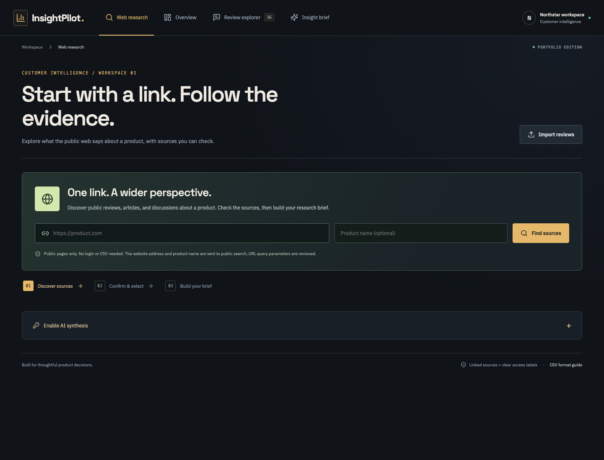
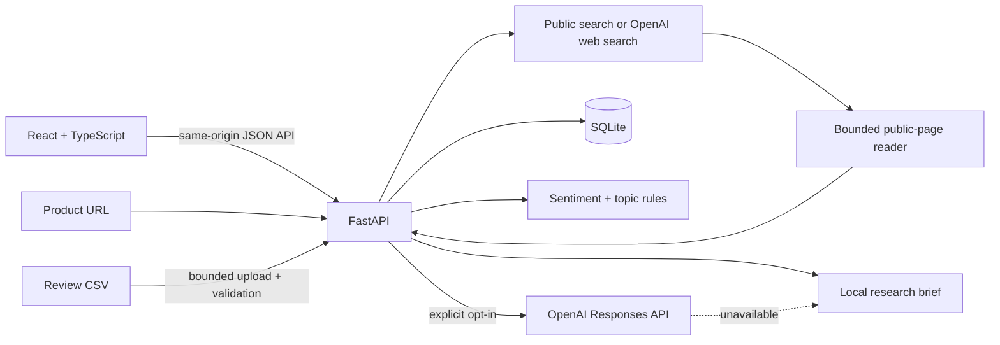

# InsightPilot

**Customer feedback, clear product priorities.**

InsightPilot starts with a product URL, finds public sources about that product, and turns selected evidence into a research brief with clickable citations. It also supports CSV review imports with a dashboard, search, and sentiment analytics. React and TypeScript power the interface; FastAPI handles research and analysis; SQLite preserves reviews and research history.



The interface uses a graphite canvas, horizontal workspace navigation, and distinct lime, cobalt, terracotta, and amber accents. The responsive layout keeps the same review workflow available on desktop and mobile.

## Run it on a Mac

You need Python 3.9+ and Node.js 22.12+ (Node 24 LTS is also suitable). From the project directory:

```bash
./scripts/setup.sh
./scripts/start.sh
```

Open [InsightPilot](http://127.0.0.1:8000). Paste a product URL into **Web research**, optionally enter its exact name, and choose **Find sources**. Confirm the identity, select relevant evidence, and build a source digest or AI brief. To explore structured review analytics, open **Overview** and choose **Explore sample workspace**, or import your own CSV. The setup script installs dependencies and builds the frontend. The start script serves the built app and API together. Stop it with `Control-C`.

If port 8000 is occupied, run `PORT=8002 ./scripts/start.sh` and open port 8002 instead. Web research needs an internet connection. The CSV dashboard, import, review explorer, and local review brief work offline after installation. Web fonts fall back to system fonts when offline.

## Research a product from one URL

1. Enter a public website URL and, optionally, the exact product name. Without a name, the domain provides an initial identity guess.
2. Discover sources with public web and news search. When a key is configured and AI search is enabled, the OpenAI Responses API's hosted web search discovers candidates instead, with public search as a fallback.
3. Inspect up to eight discovered results plus the submitted website. Each source is labeled **Page text read**, **Search excerpt only**, or **Unavailable**. Company pages are distinguished from third-party sources.
4. Confirm the product name and select sources. Namesakes and unrelated results can be excluded. Readable sources are selected by default; excerpts can be included deliberately.
5. Build a local extractive digest, or opt in to AI synthesis. Reports cite the selected source URLs and can be exported as Markdown. Recent research is saved in SQLite and can be reopened.

The research workflow does not convert articles into fictional customer reviews or invent a sentiment percentage. No web research data is added to the CSV review dataset. A third-party article is not automatically an individual review, and a source's age matters when interpreting its claims.

### Connect AI without editing a file

Expand **Enable AI synthesis** and enter an OpenAI API key. It stays in backend memory until server restart, rather than in browser storage or SQLite. Saving a key does not validate its provider permissions; the first AI request does. Alternatively, configure `.env` as described below.

Enable **AI-assisted web search and synthesis** to use hosted search during discovery. Before building a brief, **Use AI synthesis** controls whether selected source text is sent to OpenAI. Provider charges may apply. Without a key, real public discovery and source collection remain available, while the output is explicitly labeled an extractive digest. An AI failure produces a visible local fallback; it does not masquerade as a successful AI result.

### Retrieval boundaries

Only public HTTP(S) pages are fetched. The reader rejects private, loopback, and link-local addresses, validates every redirect, checks DNS answers, and connects to the validated IP while preserving TLS hostname verification. User-submitted URL queries are removed before search; functional query parameters on discovered source links are retained while common tracking and credential parameters are stripped.

Reading respects the initial site's robots policy, stops at access restrictions, and does not bypass login, CAPTCHA, or paywalls. Each response is capped at 750 KB and extracted text at 18,000 characters. There is no JavaScript renderer; some pages therefore remain search excerpts. Public search can be unavailable, stale, or incomplete. At most two research jobs run at a time, with four concurrent source readers per discovery. Jobs interrupted by a restart are marked failed and can be rerun.

## What you can do with a review dataset

- **Import reviews:** validate UTF-8 CSV files, report rejected rows, and skip exact duplicates. Valid rows are committed together in one transaction.
- **Explore the dashboard:** track review volume, average rating, sentiment, recurring topics, and monthly trends.
- **Follow the evidence:** search review text, filter by source and sentiment, and browse paginated reviews. Filters also scope the dashboard and brief.
- **Generate a research brief:** use local analysis or explicitly opt in to OpenAI. Both paths identify their source; the local brief cites actual review IDs.
- **Export and revisit:** download a Markdown brief and keep reviews across app restarts in SQLite.

The sample workspace is intentionally fictional. It is suitable for a demo, not evidence about a real product or market.

## CSV format

```csv
text,rating,date,source
"Easy setup and a helpful support team.",5,2026-10-20,App Store
"The report export is too slow.",2,2026-10-21,G2
```

Only `text` is required. Optional fields:

| Column | Accepted value | Default |
| --- | --- | --- |
| `text` | 3–10,000 characters | Required |
| `rating` | Integer from 1 to 5 | Unrated |
| `date` | Calendar date in `YYYY-MM-DD` format | Backend's current date |
| `source` | Up to 80 characters | CSV import |

Files are limited to 2 MB and 5,000 rows. Use quotes around text containing commas or newlines. A UTF-8 byte order mark is supported. Extra named columns are ignored. Malformed encoding, duplicate headers, missing text headers, or excessive row counts reject the file without writing any rows. Row validation errors allow the remaining valid rows to import; the response includes the total rejected count and the first 50 errors.

A duplicate means identical normalized text, rating, date, and source. The same text from a different source remains a separate review. Importing a text-only file on another date creates new records because its default date changes.

## Optional AI integration

Copy the environment template:

```bash
cp .env.example .env
```

Set `OPENAI_API_KEY` in `.env`, optionally change `OPENAI_MODEL`, then restart the server. The default model is `gpt-4.1-mini`; availability depends on the API account. The key is read only by the backend and never included in the browser bundle.

In **Insight brief**, select **Use OpenAI**, then generate. This sends aggregate metrics and up to 60 recent reviews in the current scope to the [OpenAI Responses API](https://platform.openai.com/docs/api-reference/responses/create). The request sets `store: false`. Review text is treated as untrusted input; instructions require evidence citations and prohibit invented data. An unavailable service, invalid key, incomplete response, or unsupported model produces a clearly labeled local fallback. The provider request times out after 35 seconds.

Local mode is the default even when a key exists. Use only feedback you have permission to share. AI output should be checked against the original reviews; prompting does not guarantee factual accuracy or complete protection against prompt injection. Paid synthesis and hosted search are covered with mocked provider contract tests; the automated suite does not spend API credits. The implementation follows the [official web search documentation](https://developers.openai.com/api/docs/guides/tools-web-search).

## How analysis works

Sentiment uses the supplied rating: 4–5 is positive, 3 is neutral, and 1–2 is negative. Without a rating, the backend compares distinct positive and negative keywords. Topics use explicit keyword sets for Performance, Ease of use, Pricing, Support, and Features; unmatched reviews fall into Other.

These are deliberately simple, inspectable rules. They can misread negation, sarcasm, synonyms, and mixed opinions. A review may match several topics, so topic totals can exceed review count. Positive share uses all scoped reviews; average rating uses only rated reviews. Trends count reviews by the date supplied in the file. They do not estimate retention, market share, or causation.

## Architecture



The backend uses parameterized SQL and opens a connection per operation. A unique fingerprint enforces duplicate detection at the database level. File parsing completes before the import transaction begins, so a file-level failure cannot leave a partial import. SQLite keeps this small, single-workspace app easy to run and inspect.

```text
backend/app/       API, public research, page reader, CSV ingestion, analytics
backend/tests/     Isolated API and service tests
frontend/src/      React views, typed API client, component tests
frontend/e2e/      Real browser workflow
sample-data/       Fictional review CSV
scripts/           Setup, start, and verification commands
.github/workflows/ Automated checks on pushes and pull requests
```

## Development and tests

For frontend hot reload, run the backend and frontend in separate terminals:

```bash
.venv/bin/python -m uvicorn app.main:app --app-dir backend --reload
```

```bash
cd frontend
npm run dev
```

Open [the Vite development server](http://127.0.0.1:5173). It proxies `/api` to port 8000. Interactive API documentation is available at [Swagger UI](http://127.0.0.1:8000/docs).

Run the API tests, React tests, TypeScript checks, and production build:

```bash
./scripts/test.sh
```

Run the browser workflow after building:

```bash
cd frontend
npx playwright install chromium
npm run test:e2e
```

The browser suite starts a separate backend on port 8001 with a fresh temporary database for each run. The research UI test uses deterministic source fixtures; backend research tests mock external network responses, and live retrieval is checked separately. The CSV browser test uses the real API. It imports samples, searches evidence, generates and downloads a brief, validates a partially invalid upload, checks persistence after reload, and checks mobile overflow. It never uses the normal app database. GitHub Actions repeats these checks on Linux.

## Scope and next steps

This is a functioning portfolio MVP for local use: one workspace, no login, no multi-user isolation, and research jobs run in process rather than through a durable external queue. Keep the server bound to localhost. Public hosting would need authentication, upload/request limits at the proxy, rate limiting and a spending budget for paid requests, encrypted key management, a durable job queue, and an explicit retention policy.

Useful next iterations would be saved import batches with deletion, an annotated evaluation set for sentiment quality, PostgreSQL for concurrent users, and cached or asynchronous AI jobs. The current review and analytics endpoints load the workspace into memory; the bounded import size is not a total database quota. Larger datasets would benefit from SQL aggregation and database-level pagination.

For the recorded test results, see [verification](VERIFICATION.md). For an interview walkthrough and exact GitHub publishing commands, see [the demo guide](INTERVIEW.md) and [publishing guide](PUBLISHING.md).
